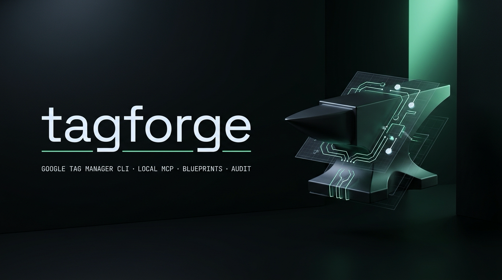
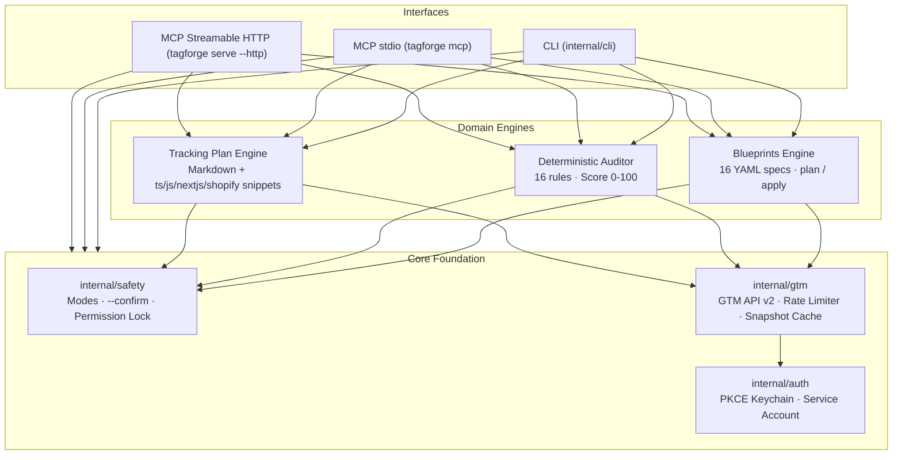

<p align="center">
  
</p>

<h1 align="center">tagforge</h1>

<p align="center">
  <strong>Safe, standards-compliant Google Tag Manager CLI and local MCP server — built in Go, local-first, zero VPS required.</strong>
</p>

<p align="center">
  <a href="https://github.com/LorranHippolyte/tagforge/releases/tag/v0.1.0"></a>
  <a href="https://github.com/LorranHippolyte/tagforge/actions/workflows/ci.yml"></a>
  <a href="go.mod"></a>
  <a href="LICENSE"></a>
  <a href="#mcp-server-setup"></a>
</p>

<p align="center">
  <a href="#installation">Installation</a> ·
  <a href="#authentication">Authentication</a> ·
  <a href="#cli-command-reference">CLI Reference</a> ·
  <a href="#official-embedded-blueprints-16">Blueprints (16)</a> ·
  <a href="#deterministic-container-auditor-16-rules">Auditor (16 Rules)</a> ·
  <a href="#mcp-server-setup">MCP Setup</a> ·
  <a href="#safety-model">Safety Model</a>
</p>

---

`tagforge` is an open-source Go CLI and Model Context Protocol (MCP) server for engineers, analytics teams, and agencies who want to inspect, configure, and audit **Google Tag Manager (Web & Server-Side)** containers reproducibly and according to official vendor schemas (GA4, Google Ads, Consent Mode v2, Meta Pixel + CAPI, TikTok, LinkedIn, Microsoft Clarity/UET, Pinterest, and Shopify Customer Events).

---

## Why `tagforge`?

Most GTM scripts and MCP wrappers either expose raw API CRUD with no guardrails — leaving LLMs to guess tag types and parameter schemas — or ship legacy templates (`gtagjs`, untyped Custom HTML, missing `event_id` deduplication).

`tagforge` enforces three engineering guarantees in Go code:

1. **Safety by Code, Not by Prompt**
   - **`workspace-only` mode is the default**: freely manage workspace resources and create versions while blocking container deletion and live publication unless `--mode full --confirm` is explicitly passed.
   - **Confirmation gates (`--confirm`)**: required on every destructive action (`delete`, built-in `disable`, `publish`).
   - **User permissions locked by default**: `accounts.user_permissions` is blocked unless `--allow-user-permissions` is explicitly enabled.
   - **Optimistic concurrency & pre-flight checks**: `fingerprint` required on updates/reverts/publish; `workspaces create-version` checks `getStatus` first and aborts on conflicts or empty workspaces; duplicate-name guards prevent accidental double creation on retries.

2. **Core-First Architecture (CLI + Local MCP + Optional HTTP)**
   - One rate-limited, cache-aware Go core powers the terminal CLI, local `stdio` MCP (`tagforge mcp`), and optional Streamable HTTP server (`tagforge serve --http`).
   - `tagforge mcp` exposes **19 consolidated tools**, **6 resources/templates**, and **7 workflow prompts** to Claude Code, Cursor, Claude Desktop, VS Code, Antigravity, and Codex without any remote server or VPS.

3. **16 Official Blueprints + 16 Deterministic Audit Rules + Tracking Plan Generator**
   - Declarative YAML blueprints (`//go:embed`) with dry-run `plan` (diff + `dataLayer` contract) and atomic `apply` (`workspace.bulkUpdate`).
   - Deterministic `tagforge audit` scoring (`0–100`, Grade `A–F`) across `privacy`, `security`, `reliability`, and `hygiene`, plus `tagforge tracking-plan` emitting Markdown docs and typed `dataLayer.push` snippets (`ts`, `js`, `nextjs`, `shopify`).

---

## Architecture



See [docs/architecture.md](docs/architecture.md) for package-level details.

---

## Installation

`tagforge` ships standalone static binaries directly from **`LorranHippolyte/tagforge`** — **100% GitHub-native, zero external registries or extra tap repositories required**.

### Homebrew (macOS & Linux)

```bash
brew tap LorranHippolyte/tagforge https://github.com/LorranHippolyte/tagforge
brew trust lorranhippolyte/tagforge
brew install --cask LorranHippolyte/tagforge/tagforge
tagforge version
```

> Homebrew 5+ requires `brew trust` once for third-party taps before loading cask files.

### Scoop (Windows)

```powershell
scoop bucket add tagforge https://github.com/LorranHippolyte/tagforge
scoop install tagforge
tagforge version
```

### Prebuilt Binaries (GitHub Releases + SHA-256 Verification)

Download the precompiled binary archive (`darwin`, `linux`, `windows` × `amd64`, `arm64`) and `checksums.txt` from [GitHub Releases (`v0.1.0`)](https://github.com/LorranHippolyte/tagforge/releases/tag/v0.1.0):

- **Windows (PowerShell, `amd64`):**
  ```powershell
  $dest = "$env:LOCALAPPDATA\Programs\tagforge"
  New-Item -ItemType Directory -Force -Path $dest | Out-Null
  Invoke-WebRequest -Uri "https://github.com/LorranHippolyte/tagforge/releases/download/v0.1.0/tagforge_0.1.0_windows_amd64.zip" -OutFile "$dest\tagforge.zip"
  Expand-Archive -Path "$dest\tagforge.zip" -DestinationPath $dest -Force
  Remove-Item "$dest\tagforge.zip"
  & "$dest\tagforge.exe" version
  ```
  *(Optional: add `$env:LOCALAPPDATA\Programs\tagforge` to your user `PATH`. For Windows ARM64, use `tagforge_0.1.0_windows_arm64.zip`.)*

- **macOS & Linux:**
  ```bash
  # Example for macOS Apple Silicon (darwin/arm64); adjust OS/arch as needed
  curl -fsSLO "https://github.com/LorranHippolyte/tagforge/releases/download/v0.1.0/tagforge_0.1.0_darwin_arm64.tar.gz"
  tar -xzf tagforge_0.1.0_darwin_arm64.tar.gz tagforge
  ./tagforge version
  ```

### Go Toolchain & From Source (`Go 1.26+`)

```bash
# Direct Go install
go install github.com/LorranHippolyte/tagforge/cmd/tagforge@v0.1.0

# Or build from source
git clone https://github.com/LorranHippolyte/tagforge.git
cd tagforge
make build
./bin/tagforge version
```

### Distribution Backlog

Scaffolding for **npm** (`npx -y tagforge` in [`packaging/npm/`](packaging/npm/)) and **WinGet** (`LorranHippolyte.tagforge`) is already wired in [`.github/workflows/release.yml`](.github/workflows/release.yml) and parked in the [distribution backlog](docs/distribution.md#distribution-backlog) while `v0.1.x` ships 100% via GitHub.

---

## Authentication

`tagforge` resolves Google Tag Manager credentials in strict precedence order:

| Priority | Method | Configuration | Recommended For |
|---|---|---|---|
| **1** | **Google Service Account** | `GOOGLE_SERVICE_ACCOUNT_KEY` (raw JSON or file path) or `GOOGLE_APPLICATION_CREDENTIALS` | CI/CD, servers, headless containers |
| **2** | **OAuth Refresh Token** | `GOOGLE_CLIENT_ID` + `GOOGLE_CLIENT_SECRET` + `GOOGLE_REFRESH_TOKEN` | Ephemeral automation environments |
| **3** | **Static Access Token** | `GOOGLE_ACCESS_TOKEN` | Short-lived debugging only |
| **4** | **Local OAuth 2.0 + PKCE** | `tagforge login --credentials-file /path/to/credentials.json` | Everyday local CLI & MCP desktop usage |

### Quickstart with Local OAuth Login

1. Enable the **Tag Manager API** in your [Google Cloud Console](https://console.cloud.google.com/).
2. Create an **OAuth 2.0 Client ID** of type **Desktop application** and download the JSON file.
3. Authenticate and verify active scopes:

```bash
tagforge login --credentials-file /path/to/credentials.json
tagforge auth status
```

Tokens are saved in your OS Keychain (`macOS Keychain` / `Windows Credential Manager` / `Linux Secret Service`) with automatic `0600` file fallback in `$XDG_CONFIG_HOME/tagforge/tokens/`. Remove stored credentials anytime with `tagforge auth logout`.

*(Never commit `credentials.json` or token files. They are git-ignored by default.)*

---

## CLI Command Reference

| Group | Subcommands | Purpose |
|---|---|---|
| `version` | — | Print build version, commit, and timestamp (`--format json` supported) |
| `login` / `auth` | `login`, `status`, `logout` | Authenticate via OAuth 2.0 PKCE, inspect scopes/expiry, clear saved profile |
| `accounts` | `list`, `get` | Inspect accessible GTM accounts |
| `containers` | `list`, `get`, `lookup`, `snippet` | List/inspect containers, look up by `GTM-...` public ID, fetch install snippet |
| `workspaces` | `list`, `get`, `create`, `status`, `sync`, `preview`, `create-version` | Safe workspace authoring, conflict detection, and named version snapshots |
| `versions` | `list`, `live`, `get`, `publish` | Inspect container versions and publish (`--mode full --confirm --fingerprint`) |
| `tags` | `list`, `get`, `create`, `update`, `delete`, `revert` | Full workspace tag management (`--confirm` required for `delete`) |
| `triggers` | `list`, `get`, `create`, `update`, `delete`, `revert` | Workspace trigger management |
| `variables` | `list`, `get`, `create`, `update`, `delete`, `revert` | User-defined variables (`Constant`, `Data Layer`, `Custom Event`, etc.) |
| `builtin-variables` | `list`, `enable`, `disable` | Inspect and toggle GTM built-in variables (`--confirm` on `disable`) |
| `folders` | `list`, `get`, `create`, `update`, `delete`, `entities` | Organize container entities by vendor or funnel stage |
| `templates` | `list`, `get`, `import-gallery` | Inspect custom templates and import verified Community Template Gallery templates |
| `clients` | `list`, `get` | Inspect Server-Side GTM (`sGTM`) clients |
| `transformations` | `list`, `get` | Inspect Server-Side GTM (`sGTM`) transformations |
| `blueprints` | `list`, `show`, `plan`, `apply` | Preview diffs and atomically apply official YAML tracking blueprints |
| `audit` | — | Deterministic privacy, security, Consent Mode v2, and hygiene audit (`--fail-on`) |
| `tracking-plan` | — | Living Markdown tracking plan + typed `dataLayer.push` snippets (`ts`/`js`/`nextjs`/`shopify`) |
| `mcp` | — | Start local MCP server over `stdio` |
| `serve` | — | Start optional remote Streamable HTTP MCP server (`--addr`, `--auth-token`, `/healthz`) |

### Quickstart Workflow Examples

```bash
# 1. Discover your account, container, and create an isolated workspace
tagforge accounts list
tagforge containers list --account 123456
tagforge workspaces create --account 123456 --container 789012 --name "feat-ga4-checkout"

# 2. Preview and apply an official blueprint atomically
tagforge blueprints list
tagforge blueprints show --name google-ga4-ecommerce
tagforge blueprints plan --name google-ga4-ecommerce --account 123456 --container 789012 --workspace 5 --param measurement_id=G-XXXXXXXXXX
tagforge blueprints apply --name meta-pixel-web --account 123456 --container 789012 --create-workspace "bp-meta-web" --import-templates --param pixel_id=123456789

# 3. Audit container hygiene & privacy (fail CI on high/critical findings)
tagforge audit --account 123456 --container 789012 --workspace 5 --fail-on high --format markdown

# 4. Generate a living tracking plan & typed Next.js dataLayer snippets
tagforge tracking-plan --account 123456 --container 789012 --workspace 5 --snippets nextjs --format markdown

# 5. Version safely and publish explicitly
tagforge workspaces create-version --account 123456 --container 789012 --workspace 5 --name "Add GA4 checkout & Meta dedup"
tagforge versions publish --account 123456 --container 789012 --version 12 --fingerprint 1732412345 --mode full --confirm
```

---

## Official Embedded Blueprints (16)

All blueprints live in [`blueprints/`](blueprints/README.md), are compiled into the binary with `//go:embed`, validate required parameters, plan exact diffs first (`plan`), and apply atomically (`workspace.bulkUpdate`).

| Blueprint ID | Context | Scope |
|---|---|---|
| `google-tag-ga4-base` | `web` | Google Tag (`googtag`) + shared Event Settings (`gtes`) |
| `google-ga4-leadgen` | `web` | GA4 Lead Generation (`generate_lead`, `form_submit`, WhatsApp link clicks) |
| `google-ga4-ecommerce` | `web` | GA4 Recommended Ecommerce (`gaawe` with `sendEcommerceData: true`) |
| `google-ads-conversions` | `web` | Conversion Linker (`gclidw`) + Conversion Tracking (`awct`) + Enhanced Conversions (`awec`) |
| `consent-mode-v2` | `web` | Google Consent Mode v2 baseline (`consentInit` defaults & update contract) |
| `meta-pixel-web` | `web` | Stape Meta Pixel Web (`stape-io/fb-tag`) + Unique Event ID (`stape-io/unique-event-id-variable`) |
| `meta-capi-sgtm` | `server` | Server-Side Meta Conversions API (`stape-io/facebook-tag`) with `event_id` deduplication |
| `tiktok-pixel-web` | `web` | Stape TikTok Pixel Web (`stape-io/tiktok-web-tag`) + Unique Event ID deduplication |
| `tiktok-events-api-sgtm` | `server` | TikTok Events API (`tiktok/gtm-template-eapi`) with `event_id` deduplication |
| `linkedin-insight-web` | `web` | LinkedIn Insight Tag 2.0 (`linkedin/linkedin-gtm-community-template`) + optional conversion |
| `linkedin-capi-sgtm` | `server` | LinkedIn CAPI (`linkedin-developers/linkedin-capi-tag-template`) with SHA-256 user matching & `eventId` |
| `microsoft-clarity-web` | `web` | Microsoft Clarity (`microsoft/clarity-gtm-template`) with explicit `analytics_storage` consent |
| `microsoft-uet-web` | `web` | Microsoft Advertising UET (`baut`) for Page Load + Variable Revenue conversions |
| `pinterest-tag-web` | `web` | Pinterest Tag (`pinterest/ws-gtm-template`) with `useGA4Ecommerce: true` & `event_id` |
| `shopify-gtm-web` | `web` | Shopify Customer Events Custom Pixel pack (Consent Mode v2 + `gtes` `page_location` + Ecommerce) |
| `shopify-sgtm-pack` | `server` | Shopify first-party sGTM GA4 Forwarder (`sgtmgaaw`) + CAPI composition playbook |

---

## Deterministic Container Auditor (16 Rules)

`tagforge audit` inspects any workspace (`--workspace`) or published version (`--live`), returns actionable remediations, computes a `0–100` score (Grade `A–F`), and supports `--fail-on critical|high|medium|low` for CI gates.

| Category | Rule ID | Default Severity | What It Detects |
|---|---|---|---|
| **Privacy** | `PII_EXPOSED_IN_PARAMS` | `critical` | Potential unhashed PII (email, phone, CPF/SSN) in tag parameters or URLs |
| **Privacy** | `CONSENT_MODE_MISSING_BASELINE` | `high` | No Google Consent Mode v2 baseline tag/template detected in container |
| **Privacy** | `CONSENT_NOT_SET_ON_MARKETING_TAG` | `high` | Non-Google marketing tag missing explicit `consentSettings` |
| **Security** | `UNSAFE_CUSTOM_HTML` | `high` | Custom HTML tags (`html`) replaceable by sandboxed Community Gallery templates |
| **Reliability** | `DEPRECATED_TAG_TYPE` | `high` | Legacy Universal Analytics (`ua`, `gaawc`) or invalid tag types |
| **Reliability** | `META_DEDUP_MISSING_EVENT_ID` | `high` | Meta Pixel Web, Meta CAPI sGTM, or legacy Custom HTML pixel missing `event_id` |
| **Reliability** | `DUPLICATE_GOOGLE_TAG` | `high` | Duplicate active Google Tags targeting the same destination ID |
| **Reliability** | `GADS_MISSING_CONVERSION_LINKER` | `high` | Active Google Ads conversion tags without an active Conversion Linker (`gclidw`) |
| **Reliability** | `PLATFORM_DEDUP_MISSING_EVENT_ID` | `medium` | TikTok Web/Events API, LinkedIn CAPI, or Pinterest tag missing `event_id` deduplication |
| **Reliability** | `TEST_EVENT_CODE_ACTIVE` | `medium` | Hardcoded or active Meta/TikTok test event codes left on active tags |
| **Reliability** | `TAG_WITHOUT_TRIGGER` | `medium` | Active (non-paused) tag with no `firingTriggerId` |
| **Hygiene** | `UNUSED_TRIGGER` | `medium` | Orphaned trigger referenced by no tags |
| **Hygiene** | `UNUSED_VARIABLE` | `medium` | Unreferenced user-defined variable across tags, triggers, and templates |
| **Hygiene** | `HARDCODED_TRACKING_ID` | `medium` | Tracking IDs or tokens hardcoded inside tags instead of `Constant` variables |
| **Hygiene** | `PAUSED_TAGS_ACCUMULATION` | `low` | Paused tags left behind in container |
| **Hygiene** | `GOVERNANCE_HYGIENE` | `low` | Unfoldered tags, high active workspace count (≥ 3), or unnamed container versions |

---

## MCP Server Setup

`tagforge mcp` runs locally over `stdio` using your OS Keychain credentials from `tagforge login` (or `GOOGLE_SERVICE_ACCOUNT_KEY` / `GOOGLE_REFRESH_TOKEN` environment variables), keeping `stdout` strictly reserved for JSON-RPC.

### Claude Code

```bash
claude mcp add tagforge -- tagforge mcp
```

### Claude Desktop / Cursor / VS Code / Antigravity / Codex

```json
{
  "mcpServers": {
    "tagforge": {
      "command": "tagforge",
      "args": ["mcp"]
    }
  }
}
```

*(Pass `"--mode", "read-only"` or `"--mode", "full"` in `args` to override the default `workspace-only` safety policy.)*

### Optional Remote Streamable HTTP Mode (`tagforge serve --http`)

For shared team deployments or web MCP connectors, run `tagforge serve --http` behind an HTTPS reverse proxy (binding non-loopback addresses refuses startup unless `--auth-token` / `TAGFORGE_HTTP_AUTH_TOKEN` is set):

```bash
export TAGFORGE_HTTP_AUTH_TOKEN="$(openssl rand -hex 32)"
tagforge serve --http --addr 0.0.0.0:8080
```

See [docs/self-hosting.md](docs/self-hosting.md) for `/healthz`, constant-time Bearer token auth, strict CORS allowlisting, and Docker Compose instructions.

<details>
<summary><strong>Full MCP Catalog: 19 Consolidated Tools · 6 Resources & Templates · 7 Prompts</strong></summary>

- **Tools (19):** `gtm_auth_status`, `gtm_guide`, `gtm_account`, `gtm_container`, `gtm_workspace`, `gtm_tag`, `gtm_trigger`, `gtm_variable`, `gtm_builtin_variable`, `gtm_folder`, `gtm_template`, `gtm_client`, `gtm_transformation`, `gtm_version`, `gtm_blueprint_list`, `gtm_blueprint_plan`, `gtm_blueprint_apply`, `gtm_audit`, `gtm_tracking_plan`.
- **Resources & URI Templates (6):** `gtm://guides`, `gtm://guides/{topic}`, `gtm://blueprints`, `gtm://blueprints/{id}`, `gtm://accounts`, `gtm://accounts/{accountId}/containers/{containerId}/workspaces/{workspaceId}/summary`.
- **Workflow Prompts (7):** `audit_container`, `generate_tracking_plan`, `setup_ecommerce`, `setup_leadgen`, `plan_safe_release`, `setup_shopify`, `setup_multiplatform_ads`.

</details>

---

## Safety Model

| Mode | Scope | Blocked Operations |
|---|---|---|
| `read-only` | Read & `quick_preview` only | All mutations, version creation, and publishing |
| `workspace-only` *(default)* | Workspace-scoped CRUD, gallery import, workspace sync & `create-version` | Live `publish`, container deletion, and `user_permissions` |
| `full` | Everything allowed in `workspace-only`, plus live `publish` & container mutations | `user_permissions` (unless `--allow-user-permissions` is also set) |

- Destructive actions (`delete`, built-in `disable`, live `publish`) always require `--confirm`.
- Least-privilege OAuth scopes map directly to the active `--mode`.
- See [docs/safety-model.md](docs/safety-model.md) for full details.

---

## Global Flags & Environment Variables

| Flag | Env Variable | Default | Description |
|---|---|---|---|
| `--mode` | `TAGFORGE_MODE` | `workspace-only` | Safety mode: `read-only`, `workspace-only`, `full` |
| `--format` | — | `table` | Output format: `table`, `json`, or `markdown` |
| `--profile` | — | `default` | Auth token profile name |
| `--confirm` | — | `false` | Required for destructive actions & publishing |
| `--allow-user-permissions` | `TAGFORGE_ALLOW_USER_PERMISSIONS` | `false` | Unlock `user_permission` operations |
| `--no-cache` | — | `false` | Disable in-memory list snapshot cache |
| `--fresh` | — | `false` | Bypass snapshot cache on list calls |
| — | `TAGFORGE_RATE_LIMIT_QPS` | `0.5` | GTM API rate limiter requests/sec |
| — | `TAGFORGE_GOOGLE_CLIENT_ID` | — | OAuth Client ID (alternative to `--credentials-file`) |
| — | `TAGFORGE_GOOGLE_CLIENT_SECRET` | — | OAuth Client Secret |
| — | `TAGFORGE_HTTP_ADDR` | `127.0.0.1:8080` | Default HTTP bind address for `tagforge serve` |
| — | `TAGFORGE_HTTP_AUTH_TOKEN` | — | Bearer token required for non-loopback HTTP mode |

---

## Documentation

- [Architecture](docs/architecture.md)
- [Safety Model](docs/safety-model.md)
- [Official Blueprints Contract](blueprints/README.md)
- [Distribution & Releases (100% GitHub-Native + Backlog)](docs/distribution.md)
- [Self-Hosting (Streamable HTTP MCP & Docker)](docs/self-hosting.md)
- [Roadmap & Backlog](docs/roadmap.md)
- [Contributing](CONTRIBUTING.md)
- [Security Policy](SECURITY.md)

---

## License

[MIT](LICENSE) © 2026 Lorran Hippolyte
